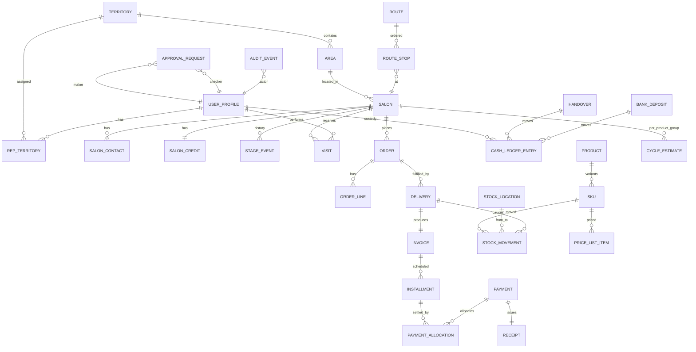

# 04 — Domain Model

The data model has three zones with different trust levels:

- **`public` zone** — everything reps can touch under RLS: salons, visits, orders, payments, stock, routes.
- **`control` zone** — approvals, audit log, anomaly flags, digests. Written by triggers and server functions only; no application role writes directly.
- **`vault` zone** (schema `supplier_vault`, see doc 12 D-13) — supplier, purchase orders, costs. No REST/API exposure; readable only through role-checked functions for users holding a vault grant (doc 07).

Below, entities are grouped by zone. "Append-only" means no `UPDATE`/`DELETE` is granted to any application role; corrections are new rows that reference the row they reverse.

## Entity overview

## `public` zone

### Organisation and people

| Entity | Key fields | Notes |
|---|---|---|
| **user_profile** | id (= auth user id), full_name, role (`owner`/`manager`/`rep`), phone, status (`active`/`suspended`/`offboarded`), cnic_encrypted, photo_url, start_date, commission_plan_id, vault_grant (bool, owner-set), created_by | One row per internal staff login. External salon customer memberships are stored separately. Staff role is checked by RLS via a stable function, never trusted from the client |
| **device** | id, user_id, device_fingerprint, platform, label, status (`pending`/`approved`/`revoked`), approved_by, approved_at, last_seen_at | Reps can only hold sessions from approved devices. A revoked device is final and status only moves forward (pending to approved or revoked, approved to revoked); a trigger enforces it for every role (migration 0007, ACTIVITY L-0112) |
| **territory** | id, name, active, created_by, created_at, updated_at | e.g., "Gulshan / Johar". Deactivated with `active`, never deleted (migration 0009) |
| **area** | id, territory_id, name, active | e.g., "Gulshan Block 13" — salon addresses resolve to an area. Deactivated with `active`, never deleted |
| **rep_territory** | rep_id, territory_id, from_date, to_date | History kept; current = `to_date is null` |

### Salons (customers)

| Entity | Key fields | Notes |
|---|---|---|
| **salon** | id, name, type (`ladies_parlor`/`mens_salon`/`unisex`/`bridal_studio`/`barber`/`hair_studio`/`spa_wellness`/`home_parlor`/`academy`/`other`), area_id, address, lat, lng (numeric(9,6), both set or both null), chairs, stage (`prospect`…`blocked`, see doc 02), verification_status (`unverified`/`otp_verified`/`verified`), source (`map_pin`/`nearby_search`/`sweep`/`excel_import`/`referral`/`manual`), discovered_by, place_id (provider id, nullable), created_by, created_at, created_at_client, updated_at; frontage_photo_url is added with storage (ACTIVITY L-0146), is_honeytoken (owner-only visibility) with honeytokens (SEC-09, Phase 3) | Migration 0009 (P1-02 part a). Stage is denormalised for speed; truth is **stage_event**. Every salon is meant to be a pin, but the database does not yet require lat and lng for a salon created from the map (open question for MJ, ACTIVITY L-0182). Never deleted; park it instead |
| **salon_note** | id, client_id, salon_id, author_id, body, created_at, created_at_client; photo_url is added with storage | The "chit" on a pin. **Append-only**; shown on the salon timeline and the rep's pin timeline |
| **discovered_place** | id, provider, place_id, name, address, geo, phone, rating, categories, raw (jsonb), discovered_by, discovered_at, from_geo (rep's fix), radius_m, status (`new`/`converted`/`dismissed`/`duplicate_of`), salon_id (when converted) | Raw results from nearby discovery, kept separate so the salon table stays clean; dedupe runs against `place_id`, phone, and name+distance |
| **discovery_run** | id, rep_id, rep_day_id, geo, radius_m, query_terms, result_count, provider_cost_units, created_at | One row per "Find salons near me" tap — also a presence record |
| **salon_contact** | id, salon_id, name, role (`owner`/`manager`/`head_stylist`/`other`), phone, is_primary, whatsapp_opt_in, active | Phone is personal data: masked in lists, revealed per record with an audit event (a rep's reveal is also a `phone_reveal` row). A retired phone is deactivated, never deleted; one active primary per salon |
| **salon_credit** | salon_id, plan_eligibility (`CASH`/`INST2`/`INST4`, ordered), credit_limit_paisa, blocked, updated_by, updated_at; exposure is derived (`app.salon_exposure`); overdue_days comes with ageing (P1-07) | Migration 0012 (P1-06 part a). No row means cash only, limit 0, not blocked. Changes only with a credit_event in the same transaction; never deleted. Until verification exists the owner sets plan and limit by hand (MJ L-0163); a manager raises an existing limit by at most 50% or unblocks, at most 2 per salon per month (CTL-08). Payments and allocations now exist (migration 0021), but payment-backed credit exposure has not been integrated. Until the separate credit-exposure work is implemented and verified, `app.salon_exposure` and the order credit gate continue to use confirmed installment orders as in A-10; do not infer that paid amounts reduce order exposure yet. Office-only at the table; reps read `app.salon_credit_status` |
| **credit_event** | id, salon_id, kind (`owner_set`/`manager_raise`/`block`/`unblock`/`order_override`/`auto_increase`/`auto_decrease`), old and new plan, limit and blocked, order_id (for `order_override`), reason, actor_id, actor_role, tx_id, created_at | Append-only (migration 0012). `order_override` records an order released over a credit hold; manager raises, unblocks and releases count toward the monthly cap |
| **stage_event** | id, salon_id, from_stage, to_stage, trigger (`created`/`visit`/`order`/`payment`/`cycle_missed`/`ageing`/`manual`), reason, actor_id (null if system), tx_id, created_at | Append-only. Manual transitions require reason. The salon's stage changes only with a stage_event in the same transaction (`tx_id`) |
| **cycle_estimate** | salon_id, product_group_id, last_order_on, cycle_days (null: the product group's default), basis (`opening`/`orders`), basis_orders, set_by, set_at; confidence is added with estimation (Phase 2) | Migration 0011 (P1-16, D-19). The office may enter an opening last purchase (A-09) only while no delivery has kept that salon and product group; deliveries keep it (basis `orders`, migration 0013) and the opening path then refuses. Next due = last purchase + cycle, computed on read by `app.due_list` (due from next due − 3 days, at risk from next due + half the cycle). Office-only at the table; never deleted |

### Field activity

| Entity | Key fields | Notes |
|---|---|---|
| **rep_day** | id, rep_id, day (Karachi date), status (`open`/`closed`/`force_closed`), check_in_at, check_in_at_client, check_in_lat/lng, bag_lines and bag_variance_units (the check-in count against the system figure), check_out_at, check_out_at_client, closed_by, close_reason; handover_id is added with handovers (P1-07) | One per rep per day (migration 0010). A rep's visits, orders and deliveries require an open rep_day. An earlier open day blocks check-in until the office force-closes it with a reason (PIP-09); a rep closes only today's day (`app.rep_check_out`). Check-out needs the evening daily close when the rep has a bag. A closed day is final |
| **route** | id, rep_id, day (Karachi date), generated_by (`manager`/`system`/`rep_map_selection`), created_by, created_at; start_geo and optimised are added with route optimisation (MAP-08, Phase 2) | One per rep per day (migration 0011). Append-only: the stops change, the route row does not. Phase 1: the office sets the stops (`app.office_set_route`), the rep adds pins (`app.rep_add_stop`) and reorders (`app.rep_reorder_route`). Whether a stop was visited is read from that day's visits |
| **route_stop** | id, route_id, sequence (1–50), salon_id, reason (`reorder_due`/`collection_due`/`at_risk`/`prospect`/`delivery`/`manual`/`pin_selected`), added_by, created_at; expected_amount_due is added with collections (P1-07) | A salon appears once per route; every stop is in the rep's current territories. Changes only while the day is today or later; a reorder changes only the sequence. The visit outcome is joined from `visit` on read (no outcome_visit_id column). Office-only at the table; reps read `app.my_route` |
| **visit** | id, client_id, salon_id, rep_id, rep_day_id, arrived_at (server), arrived_at_client, lat, lng, distance_from_pin_m, outcome (`order`/`collection`/`sample`/`quote`/`intro`/`no_decision`/`closed_not_interested`/`not_present`), notes, mock_location; photo_url is added with storage | **Append-only** (migration 0010). Server time is authoritative; client time kept for offline analysis. A first real visit moves a prospect to visited; a sample or quote moves it to trial (stage_event trigger `visit`). Office-only at the table; reps read `app.salon_visits` |
| **task** | id, kind (`reorder_due`/`collection`/`win_back`/`manager_call`/`balance_confirm`/`spot_check`/`approval`), salon_id, assignee_id, due_at, status, source | Generated by the system from cycles, ageing, and controls |

### Orders and delivery

| Entity | Key fields | Notes |
|---|---|---|
| **order** (`sales_order`) | id, client_id, salon_id, rep_id, rep_day_id, visit_id, plan (`CASH`/`INST2`/`INST4`), delivery_mode (`bag_now`/`warehouse`), status (`draft`/`confirmed`/`partially_delivered`/`delivered`/`closed`/`cancelled`), subtotal_paisa (list), discount_paisa, total_paisa, discount_approval_id, hold_credit (`blocked`/`plan_not_allowed`/`over_limit`), hold_discount (`pending`/`rejected`), credit_snapshot, credit_override_by and reason, created_at, created_at_client, confirmed_at, cancelled_at, cancelled_by, cancel_reason | Migration 0012 (P1-06 part a); named `sales_order` because `order` is an SQL keyword. Created through rep_visit or salon_portal. A rep order requires verified rep-day/visit context; a portal order derives salon identity from active salon membership and has no rep attribution. Both share the same backend price, credit and stock checks. A failed credit check leaves a draft with its holds, rechecked with `app.recheck_order` (ORD-10). A cash order needs no credit, even for a blocked salon (MJ L-0163). Amounts and parties never change; the status moves forward only. The rep cancels its own draft; the office cancels before delivery, with a reason |
| **order_line** (`sales_order_line`) | id, order_id, line_no, sku_id, qty, list_price_paisa (copied at order time), unit_price_paisa (≤ list), line_total_paisa | Append-only (migration 0012). Any unit price below list puts the whole order behind one `discount` approval (CTL-07); the owner decides above the doc 13 §9 threshold |
| **delivery** | id, client_id, order_id, salon_id, from_location_id, delivered_by, delivered_by_role, rep_day_id, status (`full`/`partial`), received_by_name, lat, lng, distance_from_pin_m, mock_location, delivered_at (server), delivered_at_client; delivery lines (`delivery_line`: order_line_id, sku_id, qty, list and unit price, line total) | Migration 0013 (P1-06 part b). Append-only. The rep delivers its own confirmed order from its own bag during an open day, with GPS; the office delivers from a warehouse (GPS optional). The acknowledgment is the receiver's name, GPS and server time (MJ L-0163); an OTP is added with SMS. Each line is one `sale` stock_movement (negative-stock guard; units promised to a pending issue are not available) and one invoice is issued. Deliveries keep cycle_estimate (basis `orders`); a third delivered order moves an active new salon to active regular |
| **invoice** | id, number (`INV-<FY>-<seq>`, gapless per FY from 1 July), delivery_id (one per delivery), order_id, salon_id, rep_id, plan, subtotal_paisa, discount_paisa, total_paisa, issued_by, issued_at; its lines are the delivery's lines | **Immutable** (migration 0013). Numbered by `app.next_doc_number('INV')` in the delivery's transaction, so a refused delivery takes no number. Corrections via **credit_note** (Phase 2). The document's data (ORD-05) is `app.invoice_document` (migration 0014): branding and company accounts from `app_config` (`company.profile`, `company.bank_accounts`, placeholders until the owner sets them, B-06), salon, lines, totals, the immutable schedule from stored `installment` rows (migration 0021): `app.plan_schedule` creates them when the invoice is issued, each installment is floored to the paisa and the last takes the remainder (A-11; invalid templates are refused under A-12); receipts allocated to this invoice are listed from stored payment allocations and the Urdu and English notices; the PDF renderer is not built yet |
| **credit_note** | id, invoice_id, amount, reason (`return`/`price_correction`/`write_off`), return_id, approval_id, issued_by | Owner approval required above threshold; write-offs owner-only |
| **return** | id, delivery_id, salon_id, rep_id, lines (jsonb), reason, photo_url, status (`requested`/`accepted`/`rejected`), accepted_by, quarantine_movement_id | Stock goes to quarantine location until accepted |

### Money

| Entity | Key fields | Notes |
|---|---|---|
| **plan_template** | id, code (`CASH`/`INST2`/`INST4`), schedule (jsonb: [{pct, day_offset}]), active | Owner-editable |
| **installment** | id, invoice_id, salon_id, seq, of_count, pct_of_total, due_on, amount_due_paisa; paid amount and status (`pending`/`partial`/`paid`/`overdue`) are derived | Migration 0021. Append-only; generated from `app.plan_schedule` by the invoice trigger at issue time, so later template edits do not rewrite an issued schedule. Invalid or zero-total schedules fail closed. Office-only at the table; reps read through `app.salon_installments` and `app.salon_balance` |
| **payment** | id, seq, client_id, salon_id, recorded_by, recorded_by_role, rep_day_id, visit_id, method (`cash`/`bank_transfer`), amount_paisa, bank_name, bank_reference, lat/lng, distance_from_pin_m, mock_location, flags, recorded_at (server), recorded_at_client | Migration 0021. Append-only and idempotent. Reps use `app.rep_record_payment` from an approved device during an open day, for a salon in their territory, with GPS. The office records cash with `app.office_record_cash` (migration 0024, MJ L-0362; flagged `office_collected`, the cash goes to the office pool) and a bank transfer with `app.office_record_payment` (flagged `on_behalf`). Reversal is not built; do not create negative payments until the approval consumer is implemented (D-25/KIR-14). Slip-photo storage is future work |
| **payment_allocation** | id, payment_id, installment_id, amount_paisa | Migration 0021. Append-only, oldest-due-first across the salon's outstanding invoices in the payment transaction. A database guard prevents allocations exceeding the installment, the payment or crossing salons. Office-only at the table |
| **receipt** | id, number (`R-<FY>-<seq>`, gapless per financial year), payment_id, salon_id, contact_id (primary active contact at issue), issued_at | Migration 0021. Append-only; issued in the payment transaction. No phone number is copied into the row. SMS/WhatsApp delivery and its delivery record are not built (B-08); issuing a receipt row is not evidence that it was sent |
| **cash_ledger_entry** | id, holder_type (`rep`/`office`/`bank`), holder_id, direction (`in`/`out`), amount_paisa, source_type (`payment`/`handover`/`deposit`/`variance`/`expense`), source_id, created_at | Migration 0021. Append-only; part a writes only `in` entries for rep cash payments. Balances are derived by summing entries. Handover, office-cash and bank-deposit movements are not yet built; do not treat the office cash-custody loop as complete |
| **handover** | id, client_id, rep_id, rep_day_id, expected_paisa (the rep's ledger balance at the count, computed by the database), counted_paisa, variance_paisa (expected minus counted, generated), variance_reason (required when they differ), counted_by, counted_by_role (owner or manager), counted_at | Migration 0023. Append-only. Two-party: final only after the rep answers in `handover_response` (L-0357) |
| **handover_response** | id, client_id, handover_id (unique: one answer), kind (`ack`/`dispute`), note (required for a dispute), responded_by, responded_at | Migration 0023. Append-only. Status is derived: no answer = pending, `ack` = final (the rep's ledger `out` of the expected amount and the office's `in` of the counted amount are written in the same transaction, A-15), `dispute` = locked for the owner, no cash moves |
| **bank_deposit** | id, deposited_by, amount, bank_account_id, slip_photo_url, deposited_at, statement_match_id, status (`recorded`/`matched`/`unmatched`) | Closes the office-cash loop |
| **bank_statement_line** | id, bank_account_id, date, amount, reference, raw, matched_to (payment or deposit), match_status | From CSV upload |
| **company_bank_account** | id, bank, title, iban_or_account, is_active, shown_on_invoice | **Owner-only** writes; change triggers notifications |

### Stock

| Entity | Key fields | Notes |
|---|---|---|
| **product_group** | id, name, default_cycle_days | e.g., Color, Developer, Shampoo, Treatment, Styling |
| **product** | id, product_group_id, brand_label (Kiran's public label), name, active | No supplier reference here — ever |
| **sku** | id, product_id, code, variant (size/shade), unit, size_value, units_per_carton, barcode, list_price_paisa (null = not yet priced, cannot be issued or sold), active | Prices in integer paisa, set by the owner only. No cost here, ever. The agent price lives in **agent_price** (sku_id, price_paisa; P1-15), a separate table, so reps never see it |
| **price_list** / **price_list_item** | id, name, effective_from, effective_to; sku_id, price | Owner-only writes |
| **stock_location** | id, kind (`warehouse`/`rep_bag`/`quarantine`/`damaged`), owner_user_id (for rep_bag), name, bag_value_limit_paisa | Independent agents have **no** location: their stock is theirs (D-15) |
| **stock_movement** | id, sku_id, qty (+/-), from_location_id, to_location_id, kind (`receipt`/`issue_to_rep`/`sale`/`return_in`/`return_to_warehouse`/`quarantine`/`write_off`/`adjustment`/`transfer`/`sale_to_agent`), source_type, source_id, batch_id, reason, photo_url, actor_id, approval_id, created_at | **Append-only.** Receipts reference a vault goods receipt by opaque id only. Quantity is always positive; direction comes from from/to. A movement never leaves any location below zero |
| **batch** | id, sku_id, batch_code, expiry_date, received_at | Supplier lot numbers are stored in the vault, not here |
| **stock_count** | id, client_id, location_id, counted_by, kind (`daily_close`/`spot_check`/`cycle_count`/`stock_take`), lines (jsonb expected vs counted), variance_units, counted_at_client, created_at | Variances create `adjustment` movements only via approval |
| **reorder_rule** | id, sku_id, reorder_point, method (`manual`/`computed`), updated_by; safety_stock and lead_time_days are added with computed reorder points (Phase 2) | |
| **stock_issue** | id, client_id, direction (`to_rep`/`to_warehouse`), warehouse_id, bag_id, lines (sku, qty), issued_by, status (`pending`/`confirmed`/`disputed`/`cancelled`), counted_lines, decided_by, decided_at, decision_note, route_date, suggestion (jsonb, INV-11), created_at | Two-party issue (CTL-05): stock moves only when the rep confirms the count; the rep can never be the issuer |
| **demand_signal** | id, client_id, sku_id (or product_group_id when Kiran does not carry the item; no free text, H-27), qty, reason (`not_in_bag`/`out_of_stock`/`not_in_catalogue`/`price`/`supply_short`/`other`), source (`visit_tap`/`order_shortfall`/`delivery_shortfall`/`agent_purchase_shortfall`/`bag_load_shortfall`), outcome (`lost`/`backordered`), salon_id, location_id, source_id, captured_by, captured_at_client, created_at | **Append-only** lost demand (DEM-01 to DEM-03). Unconstrained demand = delivered + lost |

## `control` zone

| Entity | Key fields | Notes |
|---|---|---|
| **approval_request** | id, kind (`discount`/`credit_override`/`adjustment`/`write_off`/`credit_note`/`return_accept`/`payment_reversal`/`device_approve`/`unblock`/`cancel_order`), subject_type, subject_id, maker_id, checker_role_required, checker_id, status, reason, decided_at | DB constraint: `checker_id <> maker_id` |
| **audit_event** | id, occurred_at, actor_id, actor_role, action, table_name, row_id, before (jsonb), after (jsonb), ip, device_id, purpose, prev_hash, hash | Trigger-populated. `hash = sha256(prev_hash ‖ row)` — a tamper-evident chain. Mirrored nightly to owner-controlled write-only storage |
| **phone_reveal** | id, salon_id, contact_id, actor_id, created_at | **Append-only** (migration 0009). One row each time a rep reveals a salon phone (`app.reveal_phone`); the owner reads it |
| **anomaly_flag** | id, kind, severity, subject_type, subject_id, details (jsonb), detected_at, status (`open`/`reviewed`/`case`), reviewed_by | From nightly jobs (doc 13 §7) |
| **case** | id, opened_by, kind, subject refs, narrative, status, resolution | Investigations |
| **digest** | id, for_user_id, date, content (jsonb), sent_at, read_at | Owner's daily exception digest |
| **balance_confirmation** | id, salon_id, rep_id, system_balance, salon_stated_balance, channel, confirmed_by, result (`match`/`mismatch`/`no_answer`), created_at | Weekly random sample |
| **notification** | id, user_id, kind, payload, read_at | |

## `vault` zone (doc 07)

| Entity | Key fields | Notes |
|---|---|---|
| **supplier** | id, legal_name_enc, trade_name_enc, country, contacts_enc, terms_enc, notes_enc | All identity fields column-encrypted |
| **supplier_document** | id, supplier_id, kind, storage_path (private bucket), uploaded_by | |
| **purchase_order** | id, supplier_id, status, ordered_at, expected_at, currency, total_cost_enc | |
| **purchase_order_line** | id, po_id, sku_id, qty, unit_cost_enc, supplier_sku_code_enc | `sku_id` is the only link to the public zone |
| **goods_receipt** | id, po_id, received_at, received_by, lines (qty, unit_cost_enc, supplier_lot_enc) | Creates public `stock_movement(kind='receipt')` via a security-definer function that passes only sku, qty, batch and an opaque receipt id |
| **cost_snapshot** | sku_id, effective_from, unit_cost_enc, method (`last`/`weighted_avg`) | Used by margin reports, vault-gated |
| **vault_access_log** | id, user_id, function_called, record_refs, purpose, occurred_at | Separate from audit_event; owner-visible |

### Salon customer access, attribution and field location

| **salon_account_user** (logical addition) | auth_user_id, salon_id, status, invited_at, activated_at, revoked_at, created_by | Customer membership is separate from user_profile.role. Default one salon per login. Membership is verified, audited, revocable and the only source of portal salon identity. Customer access is through narrow portal functions, not direct access to internal CRM tables |
| **salon_rep_assignment_event** (logical addition) | id, salon_id, rep_id, effective_from, effective_to, assigned_by, reason, created_at | Append-only assignment history. Current assignment is derived; original acquisition rep remains separate and immutable. Historical orders retain their order-time attribution |
| **rep_location_ping** (logical addition) | id, rep_id, rep_day_id, lat, lng, accuracy_m, captured_at_client, received_at_server, device_id, mock_location, created_at | Append-only location samples accepted only for the authenticated rep's open rep_day. Office current-location/history functions are role- and purpose-scoped. Cadence, background behaviour and retention are subject to OQ-32 |
| **sales_order channel/provenance fields** | source_channel (`office`/`salon_portal`, D-30), created_by_auth_user_id, intake_card_id (nullable, the rep's order-intake card), delivering rep (nullable), rep_day_id (nullable), visit_id (nullable), idempotency_key | Extend the canonical sales_order without creating a second order table. Server derives creator/channel from authentication; a salon portal order has no fabricated rep/visit/day. Preserve salon acquisition and current assignment independently |
| **salon price mapping** | salon_id or approved price_list assignment, sku_id, effective_from/to, price_paisa, changed_by, reason | The exact physical design must be reconciled with the active price-list implementation. Price writes remain Owner-only under D-08; order lines retain immutable price snapshots |
| **customer-safe stock projection** | sku_id, total_on_hand, reserved_qty, available_to_order, as_of | A controlled function/view only. No internal stock_location, rep bag, supplier, cost, margin, lot or custody fields are exposed to salon users |

The existing public staff identity model remains owner/manager/rep. Do not add salon to the staff role enum as a shortcut. The salon portal must resolve an authenticated customer membership separately, and each customer RPC must prove that membership before reading or writing.

## Invariants the database must enforce

1. **Append-only tables**: `visit`, `salon_note`, `discovery_run`, `stage_event`, `credit_event`, `payment`, `payment_allocation`, `cash_ledger_entry`, `stock_movement`, `stock_count`, `demand_signal`, `audit_event`, `invoice`, `receipt`, `sales_order_line`, `delivery`, `delivery_line`, `phone_reveal`, and the `route` row (its stops are the only part that changes). Grant `INSERT` + `SELECT` only; corrections are reversing rows.
2. **Balances are derived**: a salon's receivable = Σ invoices − Σ allocations − Σ credit notes; a rep's cash = Σ cash_ledger entries for that holder; stock at a location = Σ movements. A nightly job recomputes and compares with any cached figures.
3. **Custody chain closure**: every cash `in` to a rep has a `payment`; every rep `out` has a `handover`; every office `out` has a `bank_deposit`; every `bank_deposit` must match a `bank_statement_line` within 3 working days or it is an open exception.
4. **Credit gate**: an installment order moves to `confirmed` only if the salon is not blocked (`salon_credit.blocked`, or its stage is `blocked`), its plan is within `plan_eligibility`, and `exposure + total ≤ credit_limit_paisa`, or the office releases the hold (a `credit_event` of kind `order_override`, within the manager cap). A cash order is never credit-checked, even for a blocked salon (doc 09 §2; MJ, ACTIVITY L-0163).
5. **Price gate**: an order with any line's `unit_price_paisa < list_price_paisa` carries one `sales_order.discount_approval_id` for the whole order and stays a draft until that approval is approved by someone other than the rep.
6. **Rep-day gate**: `order`, `payment`, `visit` inserts require an open `rep_day` for the actor (reps only).
7. **Device gate**: rep sessions are rejected unless the request's device is `approved` for that user.
8. **Maker ≠ checker** on every `approval_request`.
9. **Vault isolation**: no foreign key from `vault` to `public` except `sku_id`; no view or function returns a vault column to a non-grantee; `supplier` is never joined into `product`.
10. **Gapless numbering** for invoices and receipts per financial year (1 July – 30 June), allocated inside the issuing transaction.
11. **Server time wins**: `created_at`/`recorded_at` are set by the database; client timestamps are stored separately for offline forensics.
12. **No hard deletes** anywhere in `public`, `control`, or `vault`. Soft-delete flags exist only for configuration entities (price lists, templates, territories, areas, products, SKUs, stock locations) and for `salon_contact.active`, which retires a phone while keeping its history (built in P1-02 part a; H-07's wording awaits MJ, ACTIVITY B-29).

## Derived views (examples)

- `v_salon_balance` — receivable, overdue amount, oldest due date, next installment.
- `v_rep_cash_position` — cash in hand now, expected handover today.
- `v_stock_on_hand` — per location × SKU, with cover days.
- `v_receivables_ageing` — buckets per salon / rep / territory. Built as the office function `app.office_receivables_ageing(p_group)` (migration 0022), not a view, so the role check sits in the function like the other office reads.
- `v_rep_scorecard_daily` — KPIs from doc 02.
- `v_margin_by_sku` — **vault-gated**: selling price vs cost_snapshot; only callable by vault grantees.

Reps never query salon tables directly: they read salon data through `app.*` functions that mask contact phones (`+920*******34`: the prefix and the last two digits) and cap page sizes (doc 06 §4). The views above are examples for office reporting.
