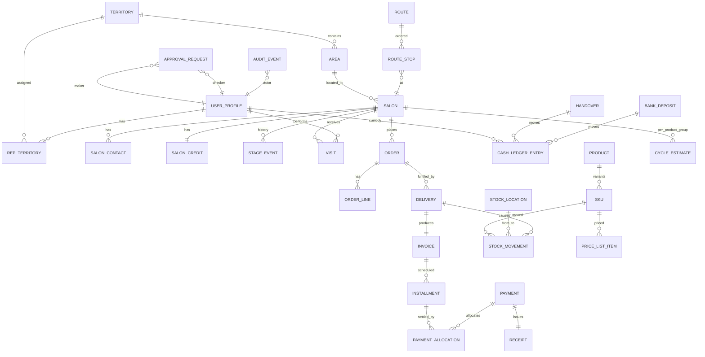

# 04 — Domain Model

The data model has three zones with different trust levels:

- **`public` zone** — everything reps can touch under RLS: salons, visits, orders, payments, stock, routes.
- **`control` zone** — approvals, audit log, anomaly flags, digests. Written by triggers and server functions only; no application role writes directly.
- **`vault` zone** (schema `supplier_vault`, see doc 12 D-13) — supplier, purchase orders, costs. No REST/API exposure; readable only through role-checked functions for users holding a vault grant (doc 07).

Below, entities are grouped by zone. "Append-only" means no `UPDATE`/`DELETE` is granted to any application role; corrections are new rows that reference the row they reverse.

## Entity overview

## `public` zone

### Organisation and people

| Entity | Key fields | Notes |
|---|---|---|
| **user_profile** | id (= auth user id), full_name, role (`owner`/`manager`/`rep`), phone, status (`active`/`suspended`/`offboarded`), cnic_encrypted, photo_url, start_date, commission_plan_id, vault_grant (bool, owner-set), created_by | One row per login. Role is a column checked by RLS via a stable function, never trusted from the client |
| **device** | id, user_id, device_fingerprint, platform, label, status (`pending`/`approved`/`revoked`), approved_by, approved_at, last_seen_at | Reps can only hold sessions from approved devices. A revoked device is final and status only moves forward (pending to approved or revoked, approved to revoked); a trigger enforces it for every role (migration 0007, ACTIVITY L-0112) |
| **territory** | id, name, status | e.g., "Gulshan / Johar" |
| **area** | id, territory_id, name | e.g., "Gulshan Block 13" — salon addresses resolve to an area |
| **rep_territory** | rep_id, territory_id, from_date, to_date | History kept; current = `to_date is null` |

### Salons (customers)

| Entity | Key fields | Notes |
|---|---|---|
| **salon** | id, name, type (`ladies_parlor`/`mens_salon`/`unisex`/`bridal_studio`/`barber`/`hair_studio`/`spa_wellness`/`home_parlor`/`academy`/`other`), area_id, address, geo (point), chairs, frontage_photo_url, stage (`prospect`…`blocked`, see doc 02), verification_status (`unverified`/`otp_verified`/`verified`), source (`map_pin`/`nearby_search`/`sweep`/`excel_import`/`referral`/`manual`), discovered_by, place_id (provider id, nullable), created_by, created_at, is_honeytoken (owner-only visibility) | Stage is denormalised for speed; truth is **stage_event**. Every salon is a pin: `geo` is required for anything created from the map |
| **salon_note** | id, salon_id, author_id, body, photo_url, created_at | The "chit" on a pin. **Append-only**; shown on the salon timeline and the rep's pin timeline |
| **discovered_place** | id, provider, place_id, name, address, geo, phone, rating, categories, raw (jsonb), discovered_by, discovered_at, from_geo (rep's fix), radius_m, status (`new`/`converted`/`dismissed`/`duplicate_of`), salon_id (when converted) | Raw results from nearby discovery, kept separate so the salon table stays clean; dedupe runs against `place_id`, phone, and name+distance |
| **discovery_run** | id, rep_id, rep_day_id, geo, radius_m, query_terms, result_count, provider_cost_units, created_at | One row per "Find salons near me" tap — also a presence record |
| **salon_contact** | id, salon_id, name, role, phone, is_primary, whatsapp_opt_in | Phone is personal data: masked in lists, revealed per record with an audit event |
| **salon_credit** | salon_id, plan_eligibility (`cash`/`inst2`/`inst4`), credit_limit, exposure (derived), overdue_days (derived), last_reviewed_by, last_reviewed_at, override_count_month | Limit changes are **credit_event** rows |
| **credit_event** | id, salon_id, kind (`auto_increase`/`auto_decrease`/`manual_override`/`block`/`unblock`), old_limit, new_limit, reason, actor_id, approval_id | Append-only |
| **stage_event** | id, salon_id, from_stage, to_stage, trigger (`order`/`payment`/`cycle_missed`/`ageing`/`manual`), reason, actor_id (null if system), created_at | Append-only. Manual transitions require reason |
| **cycle_estimate** | salon_id, product_group_id, cycle_days, confidence, last_order_at, next_due_at, basis_orders | Recomputed after every delivery |

### Field activity

| Entity | Key fields | Notes |
|---|---|---|
| **rep_day** | id, rep_id, date, check_in_at, check_in_geo, bag_count_confirmed, check_out_at, handover_id, stock_close_id, status (`open`/`closed`/`locked`) | One per rep per day. Orders require an open rep_day |
| **route** | id, rep_id, date, generated_by (`manager`/`system`/`rep_map_selection`), start_geo, optimised (bool), status | A rep can build today's route by selecting pins on the map; the app orders them from the rep's position |
| **route_stop** | id, route_id, sequence, salon_id, reason (`reorder_due`/`collection_due`/`at_risk`/`prospect`/`delivery`/`manual`/`pin_selected`), expected_amount_due, outcome_visit_id | |
| **visit** | id, salon_id, rep_id, rep_day_id, arrived_at (server), arrived_at_client, geo, distance_from_pin_m, outcome (`order`/`collection`/`sample`/`intro`/`no_decision`/`closed_not_interested`/`not_present`), notes, photo_url, mock_location_flag | **Append-only.** Server time is authoritative; client time kept for offline analysis |
| **task** | id, kind (`reorder_due`/`collection`/`win_back`/`manager_call`/`balance_confirm`/`spot_check`/`approval`), salon_id, assignee_id, due_at, status, source | Generated by the system from cycles, ageing, and controls |

### Orders and delivery

| Entity | Key fields | Notes |
|---|---|---|
| **order** | id, salon_id, rep_id, visit_id, status (`draft`/`confirmed`/`partially_delivered`/`delivered`/`closed`/`cancelled`), plan_template_id, delivery_mode (`bag_now`/`warehouse`), credit_check_result, credit_override_approval_id, created_at_client, created_at | Cancel only before delivery, manager+ with reason |
| **order_line** | id, order_id, sku_id, qty, list_price, unit_price, discount_pct, discount_approval_id | `unit_price < list_price` requires an approval |
| **delivery** | id, order_id, delivered_by, delivered_at, from_location_id, status (`full`/`partial`), salon_ack (signature image or OTP), geo | Creates **stock_movement** rows and one **invoice** |
| **invoice** | id, number (gapless per FY), delivery_id, salon_id, subtotal, discount, total, plan_template_id, issued_at, pdf_url | **Immutable.** Corrections via **credit_note** |
| **credit_note** | id, invoice_id, amount, reason (`return`/`price_correction`/`write_off`), return_id, approval_id, issued_by | Owner approval required above threshold; write-offs owner-only |
| **return** | id, delivery_id, salon_id, rep_id, lines (jsonb), reason, photo_url, status (`requested`/`accepted`/`rejected`), accepted_by, quarantine_movement_id | Stock goes to quarantine location until accepted |

### Money

| Entity | Key fields | Notes |
|---|---|---|
| **plan_template** | id, code (`CASH`/`INST2`/`INST4`), schedule (jsonb: [{pct, day_offset}]), active | Owner-editable |
| **installment** | id, invoice_id, seq, due_date, amount_due, amount_paid (derived), status (`pending`/`partial`/`paid`/`overdue`) | Generated at invoice issue |
| **payment** | id, salon_id, rep_id, visit_id, method (`cash`/`bank_transfer`), amount, bank_name, bank_reference, slip_photo_url, recorded_at (server), recorded_at_client, geo, distance_from_pin_m, flags (jsonb) | **Append-only.** Reversal = new payment with negative amount referencing original, manager+ with approval |
| **payment_allocation** | payment_id, installment_id, amount | Oldest-due-first by default |
| **receipt** | id, number (gapless), payment_id, sent_to_phone, channel, delivery_status, sent_at | A payment without a delivered receipt is an open exception |
| **cash_ledger_entry** | id, holder_type (`rep`/`office`/`bank`), holder_id, direction (`in`/`out`), amount, source_type (`payment`/`handover`/`deposit`/`variance`/`expense`), source_id, created_at | The cash custody chain. Balances are sums of entries |
| **handover** | id, rep_id, rep_day_id, expected_amount (system), counted_amount (manager), variance, variance_reason, manager_id, rep_ack_at, status (`pending_ack`/`final`/`disputed`), created_at | Two-party. Final only after rep acknowledges |
| **bank_deposit** | id, deposited_by, amount, bank_account_id, slip_photo_url, deposited_at, statement_match_id, status (`recorded`/`matched`/`unmatched`) | Closes the office-cash loop |
| **bank_statement_line** | id, bank_account_id, date, amount, reference, raw, matched_to (payment or deposit), match_status | From CSV upload |
| **company_bank_account** | id, bank, title, iban_or_account, is_active, shown_on_invoice | **Owner-only** writes; change triggers notifications |

### Stock

| Entity | Key fields | Notes |
|---|---|---|
| **product_group** | id, name, default_cycle_days | e.g., Color, Developer, Shampoo, Treatment, Styling |
| **product** | id, product_group_id, brand_label (Kiran's public label), name, active | No supplier reference here — ever |
| **sku** | id, product_id, code, variant (size/shade), unit, size, units_per_carton, barcode, list_price_paisa (null = not yet priced, cannot be issued or sold), active | Prices in integer paisa, set by the owner only. No cost here, ever. The agent price lives in **agent_price** (sku_id, price_paisa; P1-15), a separate table, so reps never see it |
| **price_list** / **price_list_item** | id, name, effective_from, effective_to; sku_id, price | Owner-only writes |
| **stock_location** | id, kind (`warehouse`/`rep_bag`/`quarantine`/`damaged`), owner_user_id (for rep_bag), name, bag_value_limit_paisa | Independent agents have **no** location: their stock is theirs (D-15) |
| **stock_movement** | id, sku_id, qty (+/-), from_location_id, to_location_id, kind (`receipt`/`issue_to_rep`/`sale`/`return_in`/`return_to_warehouse`/`quarantine`/`write_off`/`adjustment`/`transfer`/`sale_to_agent`), source_type, source_id, batch_id, reason, photo_url, actor_id, approval_id, created_at | **Append-only.** Receipts reference a vault goods receipt by opaque id only | Quantity is always positive; direction comes from from/to. A movement never leaves any location below zero
| **batch** | id, sku_id, batch_code, expiry_date, received_at | Supplier lot numbers are stored in the vault, not here |
| **stock_count** | id, location_id, counted_by, kind (`daily_close`/`spot_check`/`stock_take`), lines (jsonb expected vs counted), variance_total, created_at | Variances create `adjustment` movements only via approval |
| **reorder_rule** | sku_id, reorder_point, safety_stock, lead_time_days, method (`manual`/`computed`) | |
| **stock_issue** | id, client_id, from_location_id (warehouse), to_location_id (rep_bag), lines (sku, qty), issued_by, status (`pending`/`confirmed`/`disputed`/`cancelled`), confirmed_by, confirmed_at, route_date, suggestion (jsonb, INV-11) | Two-party issue (CTL-05): stock moves only when the rep confirms the count; the rep can never be the issuer |
| **demand_signal** | id, client_id, sku_id (or product_group_id when Kiran does not carry the item; no free text, H-27), qty, reason (`not_in_bag`/`out_of_stock`/`not_in_catalogue`/`price`/`supply_short`/`other`), source (`visit_tap`/`order_shortfall`/`delivery_shortfall`/`agent_purchase_shortfall`/`bag_load_shortfall`), outcome (`lost`/`backordered`), salon_id, location_id, source_id, captured_by, captured_at_client, created_at | **Append-only** lost demand (DEM-01 to DEM-03). Unconstrained demand = delivered + lost |

## `control` zone

| Entity | Key fields | Notes |
|---|---|---|
| **approval_request** | id, kind (`discount`/`credit_override`/`adjustment`/`write_off`/`credit_note`/`return_accept`/`payment_reversal`/`device_approve`/`unblock`/`cancel_order`), subject_type, subject_id, maker_id, checker_role_required, checker_id, status, reason, decided_at | DB constraint: `checker_id <> maker_id` |
| **audit_event** | id, occurred_at, actor_id, actor_role, action, table_name, row_id, before (jsonb), after (jsonb), ip, device_id, purpose, prev_hash, hash | Trigger-populated. `hash = sha256(prev_hash ‖ row)` — a tamper-evident chain. Mirrored nightly to owner-controlled write-only storage |
| **anomaly_flag** | id, kind, severity, subject_type, subject_id, details (jsonb), detected_at, status (`open`/`reviewed`/`case`), reviewed_by | From nightly jobs (doc 13 §7) |
| **case** | id, opened_by, kind, subject refs, narrative, status, resolution | Investigations |
| **digest** | id, for_user_id, date, content (jsonb), sent_at, read_at | Owner's daily exception digest |
| **balance_confirmation** | id, salon_id, rep_id, system_balance, salon_stated_balance, channel, confirmed_by, result (`match`/`mismatch`/`no_answer`), created_at | Weekly random sample |
| **notification** | id, user_id, kind, payload, read_at | |

## `vault` zone (doc 07)

| Entity | Key fields | Notes |
|---|---|---|
| **supplier** | id, legal_name_enc, trade_name_enc, country, contacts_enc, terms_enc, notes_enc | All identity fields column-encrypted |
| **supplier_document** | id, supplier_id, kind, storage_path (private bucket), uploaded_by | |
| **purchase_order** | id, supplier_id, status, ordered_at, expected_at, currency, total_cost_enc | |
| **purchase_order_line** | id, po_id, sku_id, qty, unit_cost_enc, supplier_sku_code_enc | `sku_id` is the only link to the public zone |
| **goods_receipt** | id, po_id, received_at, received_by, lines (qty, unit_cost_enc, supplier_lot_enc) | Creates public `stock_movement(kind='receipt')` via a security-definer function that passes only sku, qty, batch and an opaque receipt id |
| **cost_snapshot** | sku_id, effective_from, unit_cost_enc, method (`last`/`weighted_avg`) | Used by margin reports, vault-gated |
| **vault_access_log** | id, user_id, function_called, record_refs, purpose, occurred_at | Separate from audit_event; owner-visible |

## Invariants the database must enforce

1. **Append-only tables**: `visit`, `salon_note`, `discovery_run`, `stage_event`, `credit_event`, `payment`, `payment_allocation`, `cash_ledger_entry`, `stock_movement`, `stock_count`, `demand_signal`, `audit_event`, `invoice`, `receipt`. Grant `INSERT` + `SELECT` only; corrections are reversing rows.
2. **Balances are derived**: a salon's receivable = Σ invoices − Σ allocations − Σ credit notes; a rep's cash = Σ cash_ledger entries for that holder; stock at a location = Σ movements. A nightly job recomputes and compares with any cached figures.
3. **Custody chain closure**: every cash `in` to a rep has a `payment`; every rep `out` has a `handover`; every office `out` has a `bank_deposit`; every `bank_deposit` must match a `bank_statement_line` within 3 working days or it is an open exception.
4. **Credit gate**: `order.status → confirmed` requires `salon.stage <> 'blocked'`, plan ∈ eligibility, and `exposure + total ≤ credit_limit` — or an approved `credit_override`.
5. **Price gate**: `order_line.unit_price < list_price` requires `discount_approval_id` with status approved.
6. **Rep-day gate**: `order`, `payment`, `visit` inserts require an open `rep_day` for the actor (reps only).
7. **Device gate**: rep sessions are rejected unless the request's device is `approved` for that user.
8. **Maker ≠ checker** on every `approval_request`.
9. **Vault isolation**: no foreign key from `vault` to `public` except `sku_id`; no view or function returns a vault column to a non-grantee; `supplier` is never joined into `product`.
10. **Gapless numbering** for invoices and receipts per financial year (1 July – 30 June), allocated inside the issuing transaction.
11. **Server time wins**: `created_at`/`recorded_at` are set by the database; client timestamps are stored separately for offline forensics.
12. **No hard deletes** anywhere in `public`, `control`, or `vault`. Soft-delete flags exist only for configuration entities (price lists, templates, territories).

## Derived views (examples)

- `v_salon_balance` — receivable, overdue amount, oldest due date, next installment.
- `v_rep_cash_position` — cash in hand now, expected handover today.
- `v_stock_on_hand` — per location × SKU, with cover days.
- `v_receivables_ageing` — buckets per salon / rep / territory.
- `v_rep_scorecard_daily` — KPIs from doc 02.
- `v_margin_by_sku` — **vault-gated**: selling price vs cost_snapshot; only callable by vault grantees.

Reps never query base tables with phone numbers or full lists directly; they read through views that mask contact phones (`03xx-xxx-1234`) and cap page sizes.
