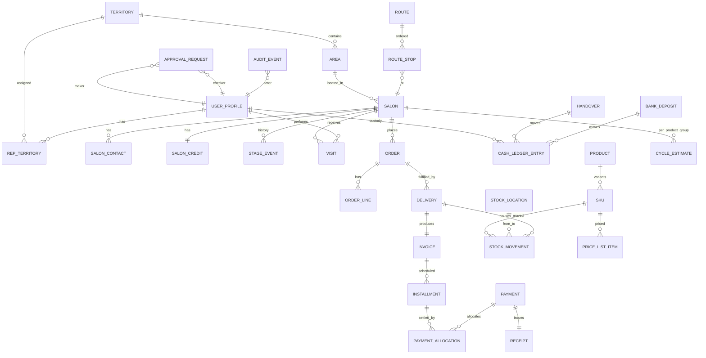

# 04 — Domain Model

The data model has three zones with different trust levels:

- **`public` zone** — everything reps can touch under RLS: salons, visits, orders, payments, stock, routes.
- **`control` zone** — approvals, audit log, anomaly flags, digests. Written by triggers and server functions only; no application role writes directly.
- **`vault` zone** (schema `supplier_vault`, see doc 12 D-13) — supplier, purchase orders, costs. No REST/API exposure; readable only through role-checked functions for users holding a vault grant (doc 07).

Below, entities are grouped by zone. "Append-only" means no `UPDATE`/`DELETE` is granted to any application role; corrections are new rows that reference the row they reverse.

## Entity overview

## `public` zone

### Organisation and people

| Entity | Key fields | Notes |
|---|---|---|
| **user_profile** | id (= auth user id), full_name, role (`owner`/`manager`/`rep`), phone, status (`active`/`suspended`/`offboarded`), cnic_encrypted, photo_url, start_date, commission_plan_id, vault_grant (bool, owner-set), created_by | One row per internal staff login. External salon customer memberships are stored separately. Staff role is checked by RLS via a stable function, never trusted from the client |
| **device** | id, user_id, device_fingerprint, platform, label, status (`pending`/`approved`/`revoked`), approved_by, approved_at, last_seen_at | Reps can only hold sessions from approved devices. A revoked device is final and status only moves forward (pending to approved or revoked, approved to revoked); a trigger enforces it for every role (migration 0007, ACTIVITY L-0112) |
| **territory** | id, name, active, created_by, created_at, updated_at | e.g., "Gulshan / Johar". Deactivated with `active`, never deleted (migration 0009) |
| **area** | id, territory_id, name, active | e.g., "Gulshan Block 13" — salon addresses resolve to an area. Deactivated with `active`, never deleted |
| **rep_territory** | rep_id, territory_id, from_date, to_date | History kept; current = `to_date is null` |

### Salons (customers)

| Entity | Key fields | Notes |
|---|---|---|
| **salon** | id, name, type (`ladies_parlor`/`mens_salon`/`unisex`/`bridal_studio`/`barber`/`hair_studio`/`spa_wellness`/`home_parlor`/`academy`/`other`), area_id, address, lat, lng (numeric(9,6), both set or both null), chairs, stage (`prospect`…`blocked`, see doc 02), verification_status (`unverified`/`otp_verified`/`verified`), source (`map_pin`/`nearby_search`/`sweep`/`excel_import`/`referral`/`manual`), discovered_by, place_id (provider id, nullable), created_by, created_at, created_at_client, updated_at; frontage_photo_url is added with storage (ACTIVITY L-0146), is_honeytoken (owner-only visibility) with honeytokens (SEC-09, Phase 3); approval_status (`pending`/`approved`/`rejected`, migration 20261105100000, D-35; a rep's new salon is pending since migration 20261105160000, slice 7) | Migration 0009 (P1-02 part a). Stage is denormalised for speed; truth is **stage_event**. Every salon is meant to be a pin, but the database does not yet require lat and lng for a salon created from the map (open question for MJ, ACTIVITY L-0182). Never deleted; park it instead. Only the office edits it (`app.update_salon` refuses reps, D-35); a rep's salon is a proposal until the office decides it. The office's salon and order timelines (`app.office_salon_timeline`, `app.office_order_timeline`, slice 7) are read from `control.audit_event`, not a second log |
| **salon_note** | id, client_id, salon_id, author_id, body, created_at, created_at_client; photo_url is added with storage | The "chit" on a pin. **Append-only**; shown on the salon timeline and the rep's pin timeline |
| **discovered_place** | id, provider, place_id, name, address, geo, phone, rating, categories, raw (jsonb), discovered_by, discovered_at, from_geo (rep's fix), radius_m, status (`new`/`converted`/`dismissed`/`duplicate_of`), salon_id (when converted) | Raw results from nearby discovery, kept separate so the salon table stays clean; dedupe runs against `place_id`, phone, and name+distance |
| **discovery_run** | id, rep_id, rep_day_id, geo, radius_m, query_terms, result_count, provider_cost_units, created_at | One row per "Find salons near me" tap — also a presence record |
| **salon_contact** | id, salon_id, name, role (`owner`/`manager`/`head_stylist`/`other`), phone, is_primary, whatsapp_opt_in, active | Phone is personal data: masked in lists, revealed per record with an audit event (a rep's reveal is also a `phone_reveal` row). A retired phone is deactivated, never deleted; one active primary per salon |
| **salon_credit** | salon_id, plan_eligibility (`CASH`/`INST2`/`INST4`, ordered), credit_limit_paisa, blocked, updated_by, updated_at; exposure is derived (`app.salon_exposure`); overdue_days comes with ageing (P1-07) | Migration 0012 (P1-06 part a). No row means cash only, limit 0, not blocked. Changes only with a credit_event in the same transaction; never deleted. Until verification exists the owner sets plan and limit by hand (MJ L-0163); a manager raises an existing limit by at most 50% or unblocks, at most 2 per salon per month (CTL-08). Payments and allocations now exist (migration 0021), but payment-backed credit exposure has not been integrated. Until the separate credit-exposure work is implemented and verified, `app.salon_exposure` and the order credit gate continue to use confirmed installment orders as in A-10; do not infer that paid amounts reduce order exposure yet. Office-only at the table; reps read `app.salon_credit_status` |
| **credit_event** | id, salon_id, kind (`owner_set`/`manager_raise`/`block`/`unblock`/`order_override`/`auto_increase`/`auto_decrease`), old and new plan, limit and blocked, order_id (for `order_override`), reason, actor_id, actor_role, tx_id, created_at | Append-only (migration 0012). `order_override` records an order released over a credit hold; manager raises, unblocks and releases count toward the monthly cap |
| **stage_event** | id, salon_id, from_stage, to_stage, trigger (`created`/`visit`/`order`/`payment`/`cycle_missed`/`ageing`/`manual`), reason, actor_id (null if system), tx_id, created_at | Append-only. Manual transitions require reason. The salon's stage changes only with a stage_event in the same transaction (`tx_id`) |
| **cycle_estimate** | salon_id, product_group_id, last_order_on, cycle_days (null: the product group's default), basis (`opening`/`orders`), basis_orders, set_by, set_at; confidence is added with estimation (Phase 2) | Migration 0011 (P1-16, D-19). The office may enter an opening last purchase (A-09) only while no delivery has kept that salon and product group; deliveries keep it (basis `orders`, migration 0013) and the opening path then refuses. Next due = last purchase + cycle, computed on read by `app.due_list` (due from next due − 3 days, at risk from next due + half the cycle). Office-only at the table; never deleted |

### Field activity

| Entity | Key fields | Notes |
|---|---|---|
| **rep_day** | id, rep_id, day (Karachi date), status (`open`/`closed`/`force_closed`), check_in_at, check_in_at_client, check_in_lat/lng, bag_lines and bag_variance_units (the check-in count against the system figure), check_out_at, check_out_at_client, closed_by, close_reason; handover_id is added with handovers (P1-07) | One per rep per day (migration 0010). A rep's visits, orders and deliveries require an open rep_day. An earlier open day blocks check-in until the office force-closes it with a reason (PIP-09); a rep closes only today's day (`app.rep_check_out`). Check-out needs the evening daily close when the rep has a bag. A closed day is final |
| **route** | id, rep_id, day (Karachi date), generated_by (`manager`/`system`/`rep_map_selection`), created_by, created_at; start_geo and optimised are added with route optimisation (MAP-08, Phase 2) | One per rep per day (migration 0011). Append-only: the stops change, the route row does not. Phase 1: the office sets the stops (`app.office_set_route`), the rep adds pins (`app.rep_add_stop`) and reorders (`app.rep_reorder_route`). Whether a stop was visited is read from that day's visits |
| **route_stop** | id, route_id, sequence (1–50), salon_id, reason (`reorder_due`/`collection_due`/`at_risk`/`prospect`/`delivery`/`manual`/`pin_selected`), added_by, created_at; expected_amount_due is added with collections (P1-07) | A salon appears once per route; every stop is in the rep's current territories. Changes only while the day is today or later; a reorder changes only the sequence. The visit outcome is joined from `visit` on read (no outcome_visit_id column). Office-only at the table; reps read `app.my_route` |
| **visit** | id, client_id, salon_id, rep_id, rep_day_id, arrived_at (server), arrived_at_client, lat, lng, distance_from_pin_m, outcome (`order`/`collection`/`sample`/`quote`/`intro`/`no_decision`/`closed_not_interested`/`not_present`), notes, mock_location; photo_url is added with storage | **Append-only** (migration 0010). Server time is authoritative; client time kept for offline analysis. A first real visit moves a prospect to visited; a sample or quote moves it to trial (stage_event trigger `visit`). Office-only at the table; reps read `app.salon_visits` |
| **task** | id, kind (`reorder_due`/`collection`/`win_back`/`manager_call`/`balance_confirm`/`spot_check`/`approval`), salon_id, assignee_id, due_at, status, source | Generated by the system from cycles, ageing, and controls |

### Orders and delivery

| Entity | Key fields | Notes |
|---|---|---|
| **order** (`sales_order`) | id, client_id, salon_id, rep_id and rep_day_id (both nullable since migration 20261104090000, for office orders), visit_id, source_channel (`rep_visit`/`office`/`salon_portal`), created_by, assigned_rep_id (nullable), intake_card_id (nullable), plan (`CASH`/`INST2`/`INST4`), delivery_mode (`bag_now`/`warehouse`), status (`draft`/`confirmed`/`partially_delivered`/`delivered`/`closed`/`cancelled`), subtotal_paisa (list), discount_paisa, total_paisa, discount_approval_id, discount_by_owner, hold_credit (`blocked`/`plan_not_allowed`/`over_limit`), hold_discount (`pending`/`rejected`), credit_snapshot, credit_override_by and reason, created_at, created_at_client, confirmed_at, cancelled_at, cancelled_by, cancel_reason | Migration 0012 (P1-06 part a); named `sales_order` because `order` is an SQL keyword. Under D-30 orders are created through the office (`app.office_create_order`, owner or manager, migration 20261104090000), directly or from a rep's order card; rep_visit rows are legacy orders made before D-30 (`app.create_order` now refuses every caller); salon_portal is reserved for orders made from a salon's request (D-34, D-41; not built). `created_by` is the signed-in user who made the order, set by the server. An office order has no rep and no rep day; its `assigned_rep_id` is the rep who delivers it, picked from the reps currently assigned to the salon's territory, or none for a manager-direct or salon order (A-16, MJ L-0385). A rep_visit order carries its rep and rep day (visit optional); a portal order will derive salon identity from active salon membership and has no rep attribution. All channels share the same backend price, credit and stock checks (`app.build_order`). A failed credit check leaves a draft with its holds, rechecked with `app.recheck_order` (ORD-10). A cash order needs no credit, even for a blocked salon (MJ L-0163). Amounts and parties never change; the status moves forward only. The rep cancels its own draft; the office cancels before delivery, with a reason |
| **order_line** (`sales_order_line`) | id, order_id, line_no, sku_id, qty, list_price_paisa (copied at order time), unit_price_paisa (≤ list), line_total_paisa | Append-only (migration 0012). Any unit price below list puts the whole order behind one `discount` approval (CTL-07); the owner decides above the doc 13 §9 threshold. The owner's own discount on an office order needs no approval (`discount_by_owner`, MJ L-0390) |
| **order_intake_card** | id, client_id, salon_id, submitter_kind (`rep`/`salon`), rep_id, rep_day_id, visit_id (nullable), salon_user_id (the salon login), body (version 1's note: 1 to 2000 characters, required on a rep card, optional on a salon request), created_at | Migration 20261104090000 (ORD-14, D-30); submitter kind, salon requests and lines built in migration 20261105150000 (slice 6, D-34). **Append-only**. A request; it is not an order. A rep card has a rep, a rep day and a note (`app.rep_create_card`: approved phone, open day, salon it reaches, optional lines); a salon request has no rep, day or visit and names the salon login (`app.salon_submit_request`). The office reads all; a rep reads its own rows and `app.my_cards`; a salon reads its own requests through `app.salon_my_requests` only |
| **order_intake_card_close** | id, card_id (unique: a card closes once), outcome (`converted`/`dismissed`/`cancelled`), order_id (when converted; one order per card), reason (when dismissed, at least 5 characters; optional when cancelled, at most 500), closed_by (the office user, or the rep who cancelled), closed_by_salon_user (the salon login that cancelled), closed_at | Migration 20261104090000; `cancelled` and closed_by_salon_user built in migration 20261105150000 (slice 6). **Append-only**. Written by `app.office_create_order` with a card (converted), `app.office_dismiss_card` (dismissed, shown to a salon as rejected, a reason of 5 to 500 characters), `app.rep_cancel_card` or `app.salon_cancel_request` (cancelled by the submitter before review). Every path locks the card row first. The office reads all; a rep reads the closes of its own cards |
| **delivery** | id, client_id, order_id, salon_id, from_location_id, delivered_by, delivered_by_role, rep_day_id, status (`full`/`partial`), received_by_name, lat, lng, distance_from_pin_m, mock_location, delivered_at (server), delivered_at_client; delivery lines (`delivery_line`: order_line_id, sku_id, qty, list and unit price, line total) | Migration 0013 (P1-06 part b). Append-only. Since D-32 (slice 4, migration 20261105130100, not verified) a rep's delivery is first a `delivery_submission` (its own or assigned confirmed order, from its bag, during an open day, with GPS) and this row is written only when the office approves it: delivered_by is the rep, the rep day and GPS are the submission's, delivered_at is the approval's server time, and the goods leave the rep's pending location; the office delivers from a warehouse (GPS optional). The acknowledgment is the receiver's name, GPS and server time (MJ L-0163); an OTP is added with SMS. Each line is one `sale` stock_movement (negative-stock guard; units promised to a pending issue are not available) and one invoice is issued. Deliveries keep cycle_estimate (basis `orders`); a third delivered order moves an active new salon to active regular |
| **invoice** | id, number (`INV-<FY>-<seq>`, gapless per FY from 1 July), delivery_id (one per delivery), order_id, salon_id, rep_id, plan, subtotal_paisa, discount_paisa, total_paisa, issued_by, issued_at, delivered_by and commission_rep_id (D-32, migration 20261105130100: who handed the goods over, and the order's assigned rep; required on new invoices, null on older ones); its lines are the delivery's lines | **Immutable** (migration 0013). Numbered by `app.next_doc_number('INV')` in the delivery's transaction, so a refused delivery takes no number. Corrections via **credit_note** (Phase 2). The document's data (ORD-05) is `app.invoice_document` (migration 0014): branding and company accounts from `app_config` (`company.profile`, `company.bank_accounts`, placeholders until the owner sets them, B-06), salon, lines, totals, the immutable schedule from stored `installment` rows (migration 0021): `app.plan_schedule` creates them when the invoice is issued, each installment is floored to the paisa and the last takes the remainder (A-11; invalid templates are refused under A-12); receipts allocated to this invoice are listed from stored payment allocations and the Urdu and English notices; the PDF renderer is not built yet |
| **invoice_draft_version** | Display text for the next invoice of an order: notes, payment instructions, a description per SKU; version per order, latest counts | **Append-only** (P1-31, D-49), migration 20261105220000. Never carries quantity, price, discount or SKU identity |
| **invoice_snapshot** | The issued invoice as it was printed (document, hash), one per invoice | **Append-only**, written by an AFTER INSERT trigger on invoice in the issuing transaction (D-49). Reprints and the salon read it; payments and the acknowledgement are overlaid live |
| **delivery_signature**, **delivery_signature_image**, **delivery_signature_use**, **delivery_signature_access** | The salon's acknowledgement of exactly the goods (hash, signatory, statement version, device, time), its private picture, the delivery it made final, and each opening of the picture | **Append-only**; no API role reads the first two; a delivery is final only with a signed, unused acknowledgement plus approval (D-49) |
| **credit_note** | id, invoice_id, amount, reason (`return`/`price_correction`/`write_off`), return_id, approval_id, issued_by | Owner approval required above threshold; write-offs owner-only |
| **return** | id, delivery_id, salon_id, rep_id, lines (jsonb), reason, photo_url, status (`requested`/`accepted`/`rejected`), accepted_by, quarantine_movement_id | Stock goes to quarantine location until accepted |

### Money

| Entity | Key fields | Notes |
|---|---|---|
| **plan_template** | id, code (`CASH`/`INST2`/`INST4`), schedule (jsonb: [{pct, day_offset}]), active | Owner-editable |
| **installment** | id, invoice_id, salon_id, seq, of_count, pct_of_total, due_on, amount_due_paisa; paid amount and status (`pending`/`partial`/`paid`/`overdue`) are derived | Migration 0021. Append-only; generated from `app.plan_schedule` by the invoice trigger at issue time, so later template edits do not rewrite an issued schedule. Invalid or zero-total schedules fail closed. Office-only at the table; reps read through `app.salon_installments` and `app.salon_balance` |
| **payment** | id, seq, client_id, salon_id, recorded_by, recorded_by_role, rep_day_id, visit_id, method (`cash`/`bank_transfer`), amount_paisa, bank_name, bank_reference, lat/lng, distance_from_pin_m, mock_location, flags, recorded_at (server), recorded_at_client | Migration 0021. Append-only and idempotent. Reps use `app.rep_record_payment` from an approved device during an open day, for a salon in their territory, with GPS. The office records cash with `app.office_record_cash` (migration 0024, MJ L-0362; flagged `office_collected`, the cash goes to the office pool) and a bank transfer with `app.office_record_payment` (flagged `on_behalf`). Reversal is not built; do not create negative payments until the approval consumer is implemented (D-25/KIR-14). Slip-photo storage is future work |
| **payment_allocation** | id, payment_id, installment_id, amount_paisa | Migration 0021. Append-only, oldest-due-first across the salon's outstanding invoices in the payment transaction. A database guard prevents allocations exceeding the installment, the payment or crossing salons. Office-only at the table |
| **receipt** | id, number (`R-<FY>-<seq>`, gapless per financial year), payment_id, salon_id, contact_id (primary active contact at issue), issued_at | Migration 0021. Append-only; issued in the payment transaction. No phone number is copied into the row. SMS/WhatsApp delivery and its delivery record are not built (B-08); issuing a receipt row is not evidence that it was sent |
| **cash_ledger_entry** | id, holder_type (`rep`/`office`/`bank`), holder_id, direction (`in`/`out`), amount_paisa, source_type (`payment`/`handover`/`deposit`/`variance`/`expense`), source_id, created_at | Migration 0021. Append-only; part a writes only `in` entries for rep cash payments. Balances are derived by summing entries. Handover, office-cash and bank-deposit movements are not yet built; do not treat the office cash-custody loop as complete |
| **handover** | id, client_id, rep_id, rep_day_id, expected_paisa (the rep's ledger balance at the count, computed by the database), counted_paisa, variance_paisa (expected minus counted, generated), variance_reason (required when they differ), counted_by, counted_by_role (owner or manager), counted_at | Migration 0023. Append-only. Two-party: final only after the rep answers in `handover_response` (L-0357) |
| **handover_response** | id, client_id, handover_id (unique: one answer), kind (`ack`/`dispute`), note (required for a dispute), responded_by, responded_at | Migration 0023. Append-only. Status is derived: no answer = pending, `ack` = final (the rep's ledger `out` of the expected amount and the office's `in` of the counted amount are written in the same transaction, A-15), `dispute` = locked for the owner, no cash moves |
| **bank_deposit** | id, deposited_by, amount, bank_account_id, slip_photo_url, deposited_at, statement_match_id, status (`recorded`/`matched`/`unmatched`) | Closes the office-cash loop |
| **bank_statement_line** | id, bank_account_id, date, amount, reference, raw, matched_to (payment or deposit), match_status | From CSV upload |
| **company_bank_account** | id, bank, title, iban_or_account, is_active, shown_on_invoice | **Owner-only** writes; change triggers notifications |

### Stock

| Entity | Key fields | Notes |
|---|---|---|
| **product_group** | id, name, default_cycle_days | e.g., Color, Developer, Shampoo, Treatment, Styling |
| **product** | id, product_group_id, brand_label (Kiran's public label), name, active, description (at most 1000 characters), image_path (an object in the private bucket `product-images`, exactly `products/{product id}/{uuid}.png`, `.jpg`, `.jpeg` or `.webp`); the last two built in migration 20261105110000, slice 2 | No supplier reference here — ever. `app.office_upsert_product`: a null description or picture keeps what is recorded, an empty string clears it |
| **sku** | id, product_id, code, variant (size/shade), unit, size_value, units_per_carton, barcode, list_price_paisa (null = not yet priced, cannot be issued or sold), active | Prices in integer paisa, set by the owner or a manager at AAL2 with a reason (`app.office_set_sku_price`, D-39; above 0 and at most `app.price_ceiling_paisa()`) or by the owner (`app.owner_set_sku_price`, kept); every change is a row of **sku_price_change** (append-only: sku_id, old and new price, reason, via, changed_by; migration 20261105110000). No cost here, ever. The agent price lives in **agent_price** (sku_id, price_paisa; P1-15), a separate table, so reps never see it |
| **price_list** / **price_list_item** | id, name, effective_from, effective_to; sku_id, price | Owner-only writes |
| **stock_location** | id, kind (`warehouse`/`rep_bag`/`quarantine`/`damaged`/`pending_delivery`), owner_user_id (for rep_bag and pending_delivery), name, bag_value_limit_paisa | Independent agents have **no** location: their stock is theirs (D-15). `pending_delivery` (D-32, migration 20261105130100): one per rep, made with the rep's bag; goods handed over and waiting for the office's decision, or rejected and not yet settled; no value limit |
| **stock_movement** | id, sku_id, qty (+/-), from_location_id, to_location_id, kind (`receipt`/`issue_to_rep`/`sale`/`return_in`/`return_to_warehouse`/`quarantine`/`write_off`/`adjustment`/`transfer`/`sale_to_agent`/`submitted_to_salon`/`pending_returned`; the last two, bag to pending and back, D-32), source_type, source_id, batch_id, reason, photo_url, actor_id, approval_id, created_at | **Append-only.** Receipts reference a vault goods receipt by opaque id only. Quantity is always positive; direction comes from from/to. A movement never leaves any location below zero |
| **batch** | id, sku_id, batch_code, expiry_date, received_at | Supplier lot numbers are stored in the vault, not here |
| **stock_count** | id, client_id, location_id, counted_by, kind (`daily_close`/`spot_check`/`cycle_count`/`stock_take`), lines (jsonb expected vs counted), variance_units, counted_at_client, created_at | Variances create `adjustment` movements only via approval |
| **reorder_rule** | id, sku_id, reorder_point, method (`manual`/`computed`), updated_by; safety_stock and lead_time_days are added with computed reorder points (Phase 2) | |
| **stock_issue** | id, client_id, direction (`to_rep`/`to_warehouse`), warehouse_id, bag_id, lines (sku, qty), issued_by, status (`pending`/`confirmed`/`disputed`/`cancelled`), counted_lines, decided_by, decided_at, decision_note, route_date, suggestion (jsonb, INV-11), created_at | Two-party issue (CTL-05): stock moves only when the rep confirms the count; the rep can never be the issuer |
| **demand_signal** | id, client_id, sku_id (or product_group_id when Kiran does not carry the item; no free text, H-27), qty, reason (`not_in_bag`/`out_of_stock`/`not_in_catalogue`/`price`/`supply_short`/`other`), source (`visit_tap`/`order_shortfall`/`delivery_shortfall`/`agent_purchase_shortfall`/`bag_load_shortfall`), outcome (`lost`/`backordered`), salon_id, location_id, source_id, captured_by, captured_at_client, created_at | **Append-only** lost demand (DEM-01 to DEM-03). Unconstrained demand = delivered + lost |

## `control` zone

| Entity | Key fields | Notes |
|---|---|---|
| **approval_request** | id, kind (`discount`/`credit_override`/`adjustment`/`write_off`/`credit_note`/`return_accept`/`payment_reversal`/`device_approve`/`unblock`/`cancel_order`), subject_type, subject_id, maker_id, checker_role_required, checker_id, status, reason, decided_at | DB constraint: `checker_id <> maker_id` |
| **audit_event** | id, occurred_at, actor_id, actor_role, action, table_name, row_id, before (jsonb), after (jsonb), ip, device_id, purpose, prev_hash, hash | Trigger-populated. `hash = sha256(prev_hash ‖ row)` — a tamper-evident chain. Mirrored nightly to owner-controlled write-only storage |
| **phone_reveal** | id, salon_id, contact_id, actor_id, created_at | **Append-only** (migration 0009). One row each time a rep reveals a salon phone (`app.reveal_phone`); the owner reads it |
| **anomaly_flag** | id, kind, severity, subject_type, subject_id, details (jsonb), detected_at, status (`open`/`reviewed`/`case`), reviewed_by | From nightly jobs (doc 13 §7) |
| **case** | id, opened_by, kind, subject refs, narrative, status, resolution | Investigations |
| **digest** | id, for_user_id, date, content (jsonb), sent_at, read_at | Owner's daily exception digest |
| **balance_confirmation** | id, salon_id, rep_id, system_balance, salon_stated_balance, channel, confirmed_by, result (`match`/`mismatch`/`no_answer`), created_at | Weekly random sample |
| **notification** | id, user_id, kind, payload, read_at | |

## `vault` zone (doc 07)

| Entity | Key fields | Notes |
|---|---|---|
| **supplier** | id, legal_name_enc, trade_name_enc, country, contacts_enc, terms_enc, notes_enc | All identity fields column-encrypted |
| **supplier_document** | id, supplier_id, kind, storage_path (private bucket), uploaded_by | |
| **purchase_order** | id, supplier_id, status, ordered_at, expected_at, currency, total_cost_enc | |
| **purchase_order_line** | id, po_id, sku_id, qty, unit_cost_enc, supplier_sku_code_enc | `sku_id` is the only link to the public zone |
| **goods_receipt** | id, po_id, received_at, received_by, lines (qty, unit_cost_enc, supplier_lot_enc) | Creates public `stock_movement(kind='receipt')` via a security-definer function that passes only sku, qty, batch and an opaque receipt id |
| **cost_snapshot** | sku_id, effective_from, unit_cost_enc, method (`last`/`weighted_avg`) | Used by margin reports, vault-gated |
| **vault_access_log** | id, user_id, function_called, record_refs, purpose, occurred_at | Separate from audit_event; owner-visible |

### Salon customer access, attribution and field location

| **salon_membership** (approved name, spec section 4; earlier the logical `salon_account_user`; migration 20261105100000, slice 1) | id, user_id (auth user), salon_id, invitation_id, full_name, email, status (`active`/`suspended`/`revoked`), status_by, status_reason, created_at, updated_at | Customer membership is separate from user_profile.role. Default one salon per login. Membership is verified, audited, revocable and the only source of portal salon identity. Customer access is through narrow portal functions, not direct access to internal CRM tables |
| **salon_rep_assignment** (approved name, spec section 4; earlier the logical `salon_rep_assignment_event`; migration 20261105100000, slice 1) | id, seq (the order of rows), client_id, salon_id, rep_id (null clears it), rate_bp (0 to 10000, used from slice 5), assigned_by, created_at | Append-only assignment history. Current assignment is derived and decides reachability (D-36); original acquisition rep remains separate and immutable. Historical orders retain their order-time attribution |
| **rep_location_ping** (logical addition) | id, rep_id, rep_day_id, lat, lng, accuracy_m, captured_at_client, received_at_server, device_id, mock_location, created_at | Append-only location samples accepted only for the authenticated rep's open rep_day. Office current-location/history functions are role- and purpose-scoped. Cadence, background behaviour and retention are subject to OQ-32 |
| **sales_order channel/provenance fields** | source_channel (`rep_visit`/`office`/`salon_portal`, D-30), created_by, intake_card_id (nullable, the rep's order card), assigned_rep_id (nullable, the delivering rep), discount_by_owner (MJ L-0390), rep_id and rep_day_id (nullable), visit_id (nullable), client_id (the idempotency key) | Built in migration 20261104090000 on the canonical sales_order, without a second order table; the planned names created_by_auth_user_id, delivering rep and idempotency_key are built as `created_by`, `assigned_rep_id` and the existing `client_id`. salon_portal is an order the office made from a salon's request (D-34; built in migration 20261105150000, check `sales_order_salon_portal_shape`: no rep, rep day or visit, and the request). Server derives creator/channel from authentication; a salon portal order has no fabricated rep/visit/day. Preserve salon acquisition and current assignment independently |
| **salon_sku_price** (approved name, spec section 4; earlier the logical "salon price mapping"; migration 20261105110000, slice 2) | id, seq (the order of rows), client_id, salon_id, sku_id, price_paisa (null clears it), reason, set_by, created_at | Append-only; the latest row by seq is the salon's price. Price writes are owner or manager with a reason through `app.office_set_salon_price`, approved salons only, at most the list price (D-37, D-39; this amends the earlier Owner-only wording under D-08). An order line given no price takes it (`app.build_order`); the price gate is unchanged (invariant 5, OQ-33 default). Dated price lists are separate (ORD-07, Phase 2). Order lines retain immutable price snapshots |
| **customer-safe stock projection** | sku_id, total_on_hand, reserved_qty, available_to_order, as_of | Phase 2 (INV-12); not in the current work (D-41). A controlled function/view only. No internal stock_location, rep bag, supplier, cost, margin, lot or custody fields are exposed to salon users |

The existing public staff identity model remains owner/manager/rep. Do not add salon to the staff role enum as a shortcut. The salon portal must resolve an authenticated customer membership separately, and each customer RPC must prove that membership before reading or writing.

## Approved, not built (doc 16, D-33 to D-41)

These tables and columns extend the existing model. MJ approved them in `docs/superpowers/specs/2026-11-05-reps-salons-catalogue-investors-design.md` section 4; the slice 1 rows are in migration 20261105100000 and the slice 2 rows in migration 20261105110000 and the slice 3 rows in migration 20261105120000 and the slice 6 rows in migration 20261105150000 (marked built below, not verified), the rest are in no migration yet, and a migration in the repository does not mean it is applied anywhere. Every new table has forced RLS, the audit trigger, and writes only through `security definer` `app.*` functions with a pinned `search_path`, `client_id` idempotency, the actor from the session and money in paisa. Salons read only through `app.salon_*` functions that resolve the salon from the active membership and return allow-listed fields. No duplicate tables: the entities below extend the canonical ones.

| Entity or addition | What | Notes |
|---|---|---|
| **invitation** | A rep or salon invitation: random token stored hashed, single use, expires in 7 days, bound to the invited email | Built, migration 20261105100000: id, client_id, kind (`rep`/`salon`), email, full_name, salon_id, token_hash (sha256), status (`pending`/`redeemed`/`revoked`; expired is read from expires_at), expires_at, invited_by, redeemed_by and redeemed_at, revoked_by, revoked_at and revoke_reason. Redeemed by the database from an emailed-code session (SEC-16); no grant to any API role |
| **salon_membership** | The salon login's link to one salon | Built, migration 20261105100000. See the table above. Not a staff role (doc 06 section 2.1) |
| **salon.approval_status** | Column on `salon`; existing rows read approved (column default) | Built, migration 20261105100000. Changes only with a decision row in the same transaction. A pending or rejected salon gets no order (`app.build_order`) and no order card (D-35) |
| **salon_approval_decision** | The office's approval or rejection of a proposed salon, with a reason | **Append-only**. Built, migration 20261105100000; one decision per salon |
| **salon_rep_assignment** | Direct assignment of a rep to a salon | **Append-only**. Built, migration 20261105100000; the latest row decides reachability (`app.rep_holds_salon`). See the table above |
| **order_intake_card additions** | `submitter_kind`; `rep_id` nullable for salon cards | One queue for rep and salon requests (D-34). Reject uses the existing `order_intake_card_close`. Built, migration 20261105150000 (slice 6), with `salon_user_id` and the close outcome `cancelled` |
| **order_intake_card_line** | Optional product lines of a request; no prices taken from the submitter | **Append-only**. Built, migration 20261105150000: id, card_id, version (1 to 51), line_no (1 to 50), sku_id, qty (1 to 10000); one SKU once per version; no price column |
| **order_intake_card versions** | Each edit of a waiting request is a new version, not an overwrite | **Append-only**. Built as `order_intake_card_version`, migration 20261105150000: id, client_id, card_id, version (2 to 51; version 1 is the card row), body, edited_by (rep) or edited_by_salon_user, created_at |
| **product.image_path, product.description** | Picture and description; bucket `product-images` (private), office writes under `products/`, read by an active staff profile or an active salon member, PNG, JPEG or WebP, 5 MB | INV-13. Built, migration 20261105110000 (the bucket and its policies only where the storage schema exists) |
| **salon_sku_price**, **sku_price_change** | Office-set price per salon and SKU; history of list price changes | **Append-only**. Built, migration 20261105110000. See the tables above; OQ-33 |
| **delivery_submission**, **delivery_submission_decision**, **pending_stock_resolution** | A rep's submission (order, salon, rep, rep day, lines, receiver, GPS, distance, device, mock flag, flags, server and phone time); the office's one decision (approved with its delivery, or rejected with a reason of 5 to 500 characters); the settlement of rejected goods (returned to the bag, to a warehouse, or missing with an approved adjustment; a count note; never more than is unsettled) | **Append-only** (D-32). Built in slice 4, migration 20261105130100, not verified. `invoice.delivered_by` (who handed the goods over) and `invoice.commission_rep_id` (the order's assigned rep) are stamped in `app.finalise_delivery`, the one finalising path |
| **rep_commission_rate** | A rep's default rate: rep_id, rate_bp (0 to 10000), reason (5 to 300), set_by, set_at, seq (the latest row is current). The per rep and salon rate is not a second table: it is `salon_rep_assignment.rate_bp` (slice 1) | **Append-only** (D-38). Built in slice 5, migration 20261105140000, not verified. `invoice.commission_rate_bp` is stamped at delivery approval in `app.finalise_delivery` beside `commission_rep_id`: the salon's latest assignment rate when it names that rep and has a rate, else the rep's latest default, else 0 (0 when the order has no assigned rep); a NOT VALID check `invoice_rate_stamped` requires it on new invoices; it never changes |
| **commission_payment** | rep_id, kind (payment or reversal), amount_paisa, reverses_id (unique: a payment is reversed once, in full), note, reason (a reversal's, 5 to 500), recorded_by, recorded_at | **Append-only** (D-38, FLD-06). Built in slice 5, not verified. A guard trigger, under a per-rep lock, refuses a payment above what is earned and unpaid and a reversal that does not mirror one payment (23514) |
| **investor**, **investment** | People and their investments | Built, migration 20261105120000 (slice 3). `investor`: id, client_id (unique per creator), full_name, phone, note, status (`active`/`closed`), created_by, created_at, updated_at; never deleted, identity immutable. `investment` is **append-only** (D-40, CAP-01): id, client_id, investor_id, amount_paisa, invested_on, note, reverses_id, reason, recorded_by, created_at |
| **investor_profit_decision**, **investor_payout** | Decisions typed by the office; payouts and reversals with reasons | Built, migration 20261105120000. **Append-only**. Both belong to one investment; a payout has kind (`profit`/`principal`), method (`cash`/`bank`/`other`) and reference. A reversal row names the row it reverses (unique `reverses_id`), is its exact negative and carries a reason. Totals derived; no formula; not posted to cash (D-40, CAP-02, CAP-03) |

The functions reused rather than duplicated are `app.build_order`, `app.office_create_order`, `app.evaluate_order`, `app.office_upsert_product`, `app.office_upsert_sku`, the payments and receivables functions and `app.office_open_cards`.

## Invariants the database must enforce

1. **Append-only tables**: `visit`, `salon_note`, `discovery_run`, `stage_event`, `credit_event`, `payment`, `payment_allocation`, `cash_ledger_entry`, `stock_movement`, `stock_count`, `demand_signal`, `audit_event`, `invoice`, `receipt`, `sales_order_line`, `delivery`, `delivery_line`, `phone_reveal`, `order_intake_card`, `order_intake_card_close`, `order_intake_card_version`, `order_intake_card_line`, `investment`, `investor_profit_decision`, `investor_payout`, and the `route` row (its stops are the only part that changes). Grant `INSERT` + `SELECT` only; corrections are reversing rows. The tables marked append-only in the section above join this list when they are built.
2. **Balances are derived**: a salon's receivable = Σ invoices − Σ allocations − Σ credit notes; a rep's cash = Σ cash_ledger entries for that holder; stock at a location = Σ movements. A nightly job recomputes and compares with any cached figures.
3. **Custody chain closure**: every cash `in` to a rep has a `payment`; every rep `out` has a `handover`; every office `out` has a `bank_deposit`; every `bank_deposit` must match a `bank_statement_line` within 3 working days or it is an open exception.
4. **Credit gate**: an installment order moves to `confirmed` only if the salon is not blocked (`salon_credit.blocked`, or its stage is `blocked`), its plan is within `plan_eligibility`, and `exposure + total ≤ credit_limit_paisa`, or the office releases the hold (a `credit_event` of kind `order_override`, within the manager cap). A cash order is never credit-checked, even for a blocked salon (doc 09 §2; MJ, ACTIVITY L-0163).
5. **Price gate**: an order with any line's `unit_price_paisa < list_price_paisa` carries one `sales_order.discount_approval_id` for the whole order and stays a draft until that approval is approved by someone other than the order's creator (`created_by`, the approval's maker; the rep for a legacy rep_visit order). The owner's own discount on an office order needs no approval: it carries no approval id and records `discount_by_owner` (MJ, ACTIVITY L-0390). How a per-salon price below list meets this gate is OQ-33; until MJ answers, the gate stays as written: a line given no price takes the salon's price (migration 20261105110000), and below list it is a discount under this gate, held unless the owner makes the office order. The list price stays the cap; a salon price left above a lowered list price is refused at order time.
6. **Rep-day gate**: `order`, `payment`, `visit` inserts require an open `rep_day` for the actor (reps only).
7. **Device gate**: rep sessions are rejected unless the request's device is `approved` for that user.
8. **Maker ≠ checker** on every `approval_request`.
9. **Vault isolation**: no foreign key from `vault` to `public` except `sku_id`; no view or function returns a vault column to a non-grantee; `supplier` is never joined into `product`.
10. **Gapless numbering** for invoices and receipts per financial year (1 July – 30 June), allocated inside the issuing transaction.
11. **Server time wins**: `created_at`/`recorded_at` are set by the database; client timestamps are stored separately for offline forensics.
12. **No hard deletes** anywhere in `public`, `control`, or `vault`. Soft-delete flags exist only for configuration entities (price lists, templates, territories, areas, products, SKUs, stock locations) and for `salon_contact.active`, which retires a phone while keeping its history (built in P1-02 part a; H-07's wording awaits MJ, ACTIVITY B-29).

## Derived views (examples)

Investor totals are built (slice 3) as office functions, not views, derived and never stored: `app.office_investors()` (each investor and one totals row), `app.office_investor_investments(investor)` and `app.office_investor_statement(investor, from, to)` (running principal outstanding and profit owed, worked out over the whole history). Commission figures are derived the same way (slice 5, not verified): earned is the sum over the rep's stamped invoices of floor(total_paisa x commission_rate_bp / 10000), floored per invoice; paid is payments minus reversals; owed is all-time earned minus all-time paid; `app.commission_statement` (internal) computes them for `app.my_commission` and `app.office_commission`.

Overview reads (slice 9, P1-26, migration 20261105180000; not verified) derive the same rows again at the moment of the call and store nothing: `app.office_overview_counts()` (orders placed this Karachi week, orders to deliver, delivery submissions waiting for approval, held orders, pending salons, open requests, invoices this week, each over every row) and `app.office_overview_rows()` (the newest 50 orders of the week, the 50 waiting longest, 50 held with their reason, the newest 20 invoices; who placed each order: a salon request or portal order, a rep card or an older rep order, or the office); `app.office_investor_month(month, investor)` (invested over all time, the typed profit decisions dated in the month, profit and principal paid in the month, profit still owed today; a reversal counts in the month of the row it reverses); `app.my_month_orders(month)` and `app.office_rep_month(month)` (a rep's orders placed in the month, attributed to `coalesce(assigned_rep_id, rep_id)` as commission is, by status, and for the office the commission earned and paid in the month and owed to date, through slice 5's internals). A month is a Karachi calendar month; a month not yet started is refused (A-20).

Rep detail and document lists (slice 10, P1-28, migration 20261105190000; not verified) store nothing either. `app.office_rep_detail(p_rep_id)` returns one rep's allow-listed rows as one JSON value, each list capped with its total over every row: the salons the rep holds today (R4, `app.rep_holds_salon`), rep days and visits, cards, the orders whose rep is that rep (the same orders as `app.rep_month_orders`), undecided submissions with the amount `app.office_pending_deliveries` works out, invoices where `invoice.rep_id` is that rep, and the bag's on-hand quantities from stock movements. `app.office_invoices(p_salon_id)` and `app.office_receipts(p_salon_id, p_invoice_id)` list ids, numbers and amounts, newest 100, with the total. Cash and commission are not repeated: the page calls `app.office_rep_cash_position` and `app.office_commission`.

- `v_salon_balance` — receivable, overdue amount, oldest due date, next installment.
- `v_rep_cash_position` — cash in hand now, expected handover today.
- `v_stock_on_hand` — per location × SKU, with cover days.
- `v_receivables_ageing` — buckets per salon / rep / territory. Built as the office function `app.office_receivables_ageing(p_group)` (migration 0022), not a view, so the role check sits in the function like the other office reads.
- `v_rep_scorecard_daily` — KPIs from doc 02.
- `v_margin_by_sku` — **vault-gated**: selling price vs cost_snapshot; only callable by vault grantees.

Reps never query salon tables directly: they read salon data through `app.*` functions that mask contact phones (`+920*******34`: the prefix and the last two digits) and cap page sizes (doc 06 §4). The views above are examples for office reporting.
